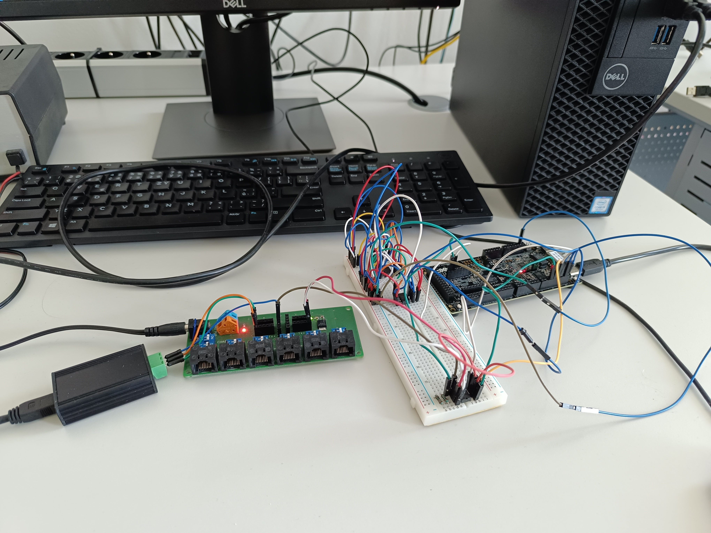

# 🌡️ Multisensory Measurement Module with Spinel Protocol

[](https://isocpp.org/)
[](https://en.wikipedia.org/wiki/C_(programming_language))
[](https://www.freertos.org/)
[](https://www.nxp.com/)
[](https://www.nxp.com/design/software/development-software/mcuxpresso-software-and-tools:MCUXPRESSO)
[-orange)](http://www.papouch.com/)
[](LICENSE)

> **Bachelor Thesis / Bakalářská práce**  
> **Topic / Téma**: Multisenzorický měřicí modul s protokolem Spinel (*Multisensory Measurement Module with Spinel Protocol*)  
> **Institution / Škola**: VŠB – Technical University of Ostrava, Faculty of Electrical Engineering and Computer Science (FEI)  
> **Author / Autor**: Pavel Valošek  

---

## 📌 Project Overview

This project implements a modular embedded temperature measurement system based on an **NXP FRDM-MCX (32-bit ARM Cortex-M33)** microcontroller running the **FreeRTOS** real-time operating system, utilizing industrial communication standards (RS485 bus and Spinel protocol).

The module periodically samples high-precision digital temperature sensors (**Dallas DS1621**) over an **I²C** bus and communicates with a supervisory computer (Master PC) across an industrial **RS485** physical bus using the structured **Spinel protocol** (supporting both ASCII and Binary frame formats). A corresponding cross-platform supervisory control application was implemented in **C++17**.


*Physical laboratory testing setup: NXP FRDM board, RS485 transceiver (MAX1487), and I²C temperature sensors (DS1621).*

---

## 🏗️ System Architecture

```text
┌──────────────────────┐         RS485 Bus (Differential)        ┌────────────────────────────────────────────────────────┐
│   Supervisory PC     │ ◄─────────────────────────────────────► │                 Embedded Sensor Module                 │
│  (C++17 Master App)  │         MAX1487 / USB-RS485             │            (NXP FRDM-MCX, ARM Cortex-M33)              │
└──────────────────────┘                                         └────────────────────────────────────────────────────────┘
                                                                                             │
                                                                                    I²C Bus (SDA / SCL)
                                                                                             │
                                                                           ┌─────────────────┴─────────────────┐
                                                                           ▼                                   ▼
                                                                 ┌───────────────────┐               ┌───────────────────┐
                                                                 │   DS1621 Sensor   │   ... up to   │   DS1621 Sensor   │
                                                                 │   (Address 0x48)  │    8 sensors  │   (Address 0x4F)  │
                                                                 └───────────────────┘               └───────────────────┘
```

### 1. ⚡ Embedded Firmware (`program/MCU/BP_RTOS`)
- **Target Microcontroller**: NXP FRDM-MCX family (ARM Cortex-M33).
- **FreeRTOS Multitasking**:
  - **Sensor Polling Task**: Periodic, non-blocking readings from multiple I²C temperature sensors (DS1621, 9-bit / 0.5 °C resolution).
  - **Spinel / UART RX Task**: Real-time interrupt-driven reception of incoming serial stream.
  - **Dispatcher / Processing Task**: Validates incoming Spinel packets, calculates checksums (CRC/SUM), queries sensor cache, and generates response frames.
- **Hardware Abstraction Layer (HAL)**: Encapsulated drivers for LP_FLEXCOMM I²C, UART/RS485 direction pin control (DE/RE), and non-volatile configuration storage.

### 2. 💻 PC Master Control Application (`program/PC`)
- **Language**: Modern C++17 (compiled via `Makefile` with `-pthread`).
- **Modes**:
  - **Monitor Mode**: Continuous background polling and logging of live temperatures.
  - **Interactive Debug Mode**: Full CLI terminal with interactive commands to query device info, change baud rates, toggle ASCII/Binary format, read raw ADC values, and manipulate user registers.
- **Platform**: Designed for Linux / POSIX environments using standard serial TTY devices (e.g., `/dev/ttyUSB0`, `/dev/ttyAMA0`, USB-RS485 converters).

### 3. 🔄 Shared Spinel Protocol Core (`program/Shared`)
The core protocol logic is fully decoupled from hardware and shared identically between MCU firmware and PC software:
- `SpinelParser`: Stream-based finite state machine (FSM) parsing byte-by-byte with frame boundary detection (`0x2A` / `0x0D` / binary markers) and byte-unstuffing.
- `FrameLayer` & `SDataLayer`: Handles addresses (0–255), sequence numbers, packet payloads, and checksum verification (simple additive checksum & CRC).
- `ProtocolConstants`: Unified command definitions (temperature read, status query, broadcast discovery, communication parameters).

---

## 📂 Repository Structure

```text
├── doc/
│   ├── BachelorThesis.pdf       # Complete formal bachelor thesis (PDF)
│   ├── lab_zapojeni.jpg         # Laboratory hardware setup photo
│   └── spinel_obecne.pdf        # Spinel protocol specification document
├── program/
│   ├── MCU/
│   │   └── BP_RTOS/             # MCUXpresso IDE project (ARM Cortex-M33 + FreeRTOS)
│   ├── PC/
│   │   ├── include/             # C++ header files for PC application
│   │   ├── src/                 # PC control application source files
│   │   └── Makefile             # GCC / Clang build configuration
│   └── Shared/
│       ├── include/             # Shared protocol headers (parser, layers, constants)
│       └── src/                 # Shared Spinel implementation
├── .gitignore
└── README.md
```

---

## 🚀 Getting Started

### Prerequisites

- **For PC Application**: `g++` or `clang++` with C++17 support and `make`.
- **For MCU Firmware**: [NXP MCUXpresso IDE](https://www.nxp.com/design/software/development-software/mcuxpresso-software-and-tools:MCUXPRESSO) (version 11.9+ recommended) with MCX SDK installed.

---

### Building & Running the PC Master Application

1. Navigate to the PC application folder:
   ```bash
   cd program/PC
   ```

2. Compile using `make`:
   ```bash
   make
   ```
   *(Binary will be output to `build/program`).*

3. Run in **Monitor Mode**:
   ```bash
   ./build/program 115200 /dev/ttyUSB0
   ```

4. Run in **Interactive Debug Mode**:
   ```bash
   ./build/program 115200 /dev/ttyUSB0 debug
   ```

#### Interactive Debug Menu Overview:
```text
--- Spinel Test Menu (DEBUG) ---
Target: BINARY / ASCII Address
------------------------
m.  Toggle Mode (Bin / Asc)
t.  Change Target Address
b.  Change local Baud rate
------------------------
1.  Get Temp (Celcius)
2.  Get Raw ADC (Binary Only)
3.  Read Device Status
4.  Set Device Status
5.  Read Info / Firmware Version
6.  Read User Data
```

---

### Importing & Flashing MCU Firmware (MCUXpresso)

1. Open **MCUXpresso IDE**.
2. Select **File -> Import... -> General -> Existing Projects into Workspace**.
3. Set the root directory to `program/MCU/BP_RTOS` and finish import.
4. Connect the **NXP FRDM-MCX** development board via USB-C (debug port).
5. Click **Build** and then **Debug** (using CMSIS-DAP / LinkServer probe).

---

## 📄 Complete Thesis Documentation

For detailed mathematical analysis, hardware schematics, FreeRTOS latency measurements, and protocol timing verification, refer to the full thesis PDF:
👉 **[`doc/BachelorThesis.pdf`](doc/BachelorThesis.pdf)**

---

## 👤 Author

- **Pavel Valošek**
- GitHub: [@Kalajengking369](https://github.com/Kalajengking369)
- Email: paja03.pv@gmail.com
- Study Programme: Informatics, VŠB – Technical University of Ostrava

